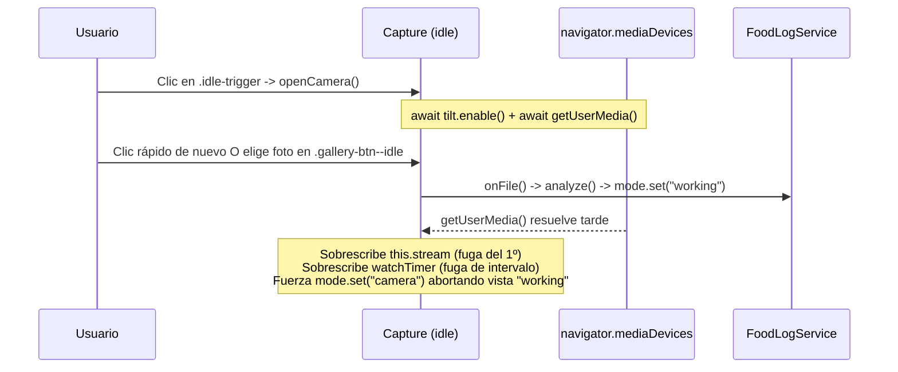

# Informe de Auditoría QA y Arquitectura Frontend — *CaloriesCounter*

Este documento recoge el diagnóstico técnico exhaustivo tras la refactorización hacia la interfaz minimalista *zero-state*, el visor inmersivo (`100dvh`) y las animaciones morfológicas guiadas por giroscopio.

---

## 1. Gestión de Estados y Ciclo de Vida

### 1.1. Condiciones de Carrera (*Race Conditions*) en Transiciones de Modo

1. **Re-entrada en [`openCamera()`](file:///c:/Users/manue/Downloads/01_Academico/Sistemas_Inteligentes/CaloriesCounter/frontend/src/app/features/capture/capture.ts#L346-L377) y fugas de hardware (`MediaStream` / `setInterval`)**:
   - El botón [`.idle-trigger`](file:///c:/Users/manue/Downloads/01_Academico/Sistemas_Inteligentes/CaloriesCounter/frontend/src/app/features/capture/capture.ts#L65) no se deshabilita ni existe un cerrojo (`opening`) mientras se resuelven `await this.tilt.enable()` y `await navigator.mediaDevices.getUserMedia(...)`.
   - Si el usuario pulsa dos veces seguidas, la segunda invocación sobrescribe `this.stream` ([`capture.ts`](file:///c:/Users/manue/Downloads/01_Academico/Sistemas_Inteligentes/CaloriesCounter/frontend/src/app/features/capture/capture.ts#L360)) **sin llamar a `track.stop()` sobre el primer `MediaStream`** y sobrescribe `this.watchTimer` ([`capture.ts`](file:///c:/Users/manue/Downloads/01_Academico/Sistemas_Inteligentes/CaloriesCounter/frontend/src/app/features/capture/capture.ts#L376)) **sin hacer `clearInterval` del temporizador previo**.
   - **Impacto**: El indicador de cámara del sistema operativo (punto verde en iOS/Android) queda encendido permanentemente hasta recargar la pestaña, incluso tras cerrar la cámara, y queda un `setInterval` huérfano ejecutándose cada `100 ms`.

2. **Colisión entre [`openCamera()`](file:///c:/Users/manue/Downloads/01_Academico/Sistemas_Inteligentes/CaloriesCounter/frontend/src/app/features/capture/capture.ts#L346-L377) en vuelo, selección de galería ([`onFile()`](file:///c:/Users/manue/Downloads/01_Academico/Sistemas_Inteligentes/CaloriesCounter/frontend/src/app/features/capture/capture.ts#L447-L455)) y destrucción del componente**:
   - Mientras `getUserMedia` espera respuesta del sistema, `mode()` sigue siendo `'idle'`. Si el usuario selecciona una imagen desde [`.gallery-btn--idle`](file:///c:/Users/manue/Downloads/01_Academico/Sistemas_Inteligentes/CaloriesCounter/frontend/src/app/features/capture/capture.ts#L94-L109) o navega a `/history` (ejecutando [`ngOnDestroy()`](file:///c:/Users/manue/Downloads/01_Academico/Sistemas_Inteligentes/CaloriesCounter/frontend/src/app/features/capture/capture.ts#L457-L463)), la promesa de `getUserMedia` continúa su ejecución tras el `await`, asigna `this.stream`, arranca `this.watchTimer` y fuerza `this.mode.set('camera')`, pisando el estado `'working'` o dejando la cámara encendida en un componente ya destruido.

3. **Ventana asíncrona desprotegida durante [`shoot()`](file:///c:/Users/manue/Downloads/01_Academico/Sistemas_Inteligentes/CaloriesCounter/frontend/src/app/features/capture/capture.ts#L412-L445)**:
   - En la línea 435, `await new Promise((resolve) => canvas.toBlob(resolve, 'image/jpeg', 0.95))` es asíncrono (~40–150 ms en resolución Full HD en móvil).
   - Durante ese `await`, los botones [`.close`](file:///c:/Users/manue/Downloads/01_Academico/Sistemas_Inteligentes/CaloriesCounter/frontend/src/app/features/capture/capture.ts#L115-L122) y [`.gallery-btn`](file:///c:/Users/manue/Downloads/01_Academico/Sistemas_Inteligentes/CaloriesCounter/frontend/src/app/features/capture/capture.ts#L184-L199) siguen activos. Si el usuario cierra la cámara en ese instante, [`closeCamera()`](file:///c:/Users/manue/Downloads/01_Academico/Sistemas_Inteligentes/CaloriesCounter/frontend/src/app/features/capture/capture.ts#L379-L392) invoca [`cancelCountdown()`](file:///c:/Users/manue/Downloads/01_Academico/Sistemas_Inteligentes/CaloriesCounter/frontend/src/app/features/capture/capture.ts#L545) que pone `this.capturing = false`, y milisegundos después `shoot()` reanuda tras `toBlob` y lanza `await this.analyze(shot)` contra la voluntad del usuario.

4. **Ventana ciega y suscripción sin cancelar en [`analyze()`](file:///c:/Users/manue/Downloads/01_Academico/Sistemas_Inteligentes/CaloriesCounter/frontend/src/app/features/capture/capture.ts#L591-L634)**:
   - `this.mode.set('working')` ([`capture.ts`](file:///c:/Users/manue/Downloads/01_Academico/Sistemas_Inteligentes/CaloriesCounter/frontend/src/app/features/capture/capture.ts#L612)) ocurre **después** de `await Promise.all([compressImage(source), readFocal35mm(source)])`. Mientras se decodifica y recomprime un archivo grande de galería (200–600 ms), la interfaz permanece en `'idle'` sin bloqueo ni indicador de carga, permitiendo disparar `onFile()` o `openCamera()` en paralelo.
   - En la línea 615, `this.sub = this.logs.analyze(...)` se asigna **sin ejecutar antes `this.sub?.unsubscribe()`**.
   - El flag `this.handedOver` ([`capture.ts`](file:///c:/Users/manue/Downloads/01_Academico/Sistemas_Inteligentes/CaloriesCounter/frontend/src/app/features/capture/capture.ts#L257)) se pone a `true` al entregar el resultado al [`ResultStore`](file:///c:/Users/manue/Downloads/01_Academico/Sistemas_Inteligentes/CaloriesCounter/frontend/src/app/core/food-log/result.store.ts#L6-L23), pero no se reinicia a `false` al comienzo de `analyze()`.

---

### 1.2. Gestión de Memoria, DOM `<video>`, Sensores y Audio

1. **Dependencia no reactiva en el `effect()` del `<video>` y retención de buffers**:
   - En el constructor de [`Capture`](file:///c:/Users/manue/Downloads/01_Academico/Sistemas_Inteligentes/CaloriesCounter/frontend/src/app/features/capture/capture.ts#L337-L343), `this.stream` es un campo privado plano (no un `signal`). El `effect()` solo funciona por accidente porque `this.videoRef()` cambia cuando `@else if (mode() === 'camera')` monta el elemento `<video>`.
   - Al ejecutar [`closeCamera()`](file:///c:/Users/manue/Downloads/01_Academico/Sistemas_Inteligentes/CaloriesCounter/frontend/src/app/features/capture/capture.ts#L379-L392), se detienen los tracks (`track.stop()`), pero **no se limpia `videoEl.srcObject = null`** antes de desmontar el `<video>`, lo que en WebKit (iOS) retrasa la liberación de los buffers de decodificación de hardware al abrir y cerrar la cámara repetidas veces.

2. **Fugas de `silenceTimer` y discrepancia de ejes en [`TiltService`](file:///c:/Users/manue/Downloads/01_Academico/Sistemas_Inteligentes/CaloriesCounter/frontend/src/app/core/tilt.service.ts#L66-L153)**:
   - En [`listen()`](file:///c:/Users/manue/Downloads/01_Academico/Sistemas_Inteligentes/CaloriesCounter/frontend/src/app/core/tilt.service.ts#L144-L153), `this.silenceTimer = setTimeout(...)` se asigna sin limpiar un `this.silenceTimer` existente si `enable()` se invoca más de una vez.
   - En [`enable()`](file:///c:/Users/manue/Downloads/01_Academico/Sistemas_Inteligentes/CaloriesCounter/frontend/src/app/core/tilt.service.ts#L105-L127), se llama a `DeviceOrientationEvent.requestPermission()` en cada apertura de cámara aunque `this.permission()` ya sea `'granted'`, añadiendo un `await` innecesario antes de `getUserMedia()` que puede invalidar el *transient user activation* en iOS.
   - **Incoherencia direccional en modo horizontal**: [`bubbleOffset()`](file:///c:/Users/manue/Downloads/01_Academico/Sistemas_Inteligentes/CaloriesCounter/frontend/src/app/core/tilt.service.ts#L46-L54) rota los ejes con [`screenAngleDeg()`](file:///c:/Users/manue/Downloads/01_Academico/Sistemas_Inteligentes/CaloriesCounter/frontend/src/app/core/tilt.service.ts#L35-L40), pero [`levelHint`](file:///c:/Users/manue/Downloads/01_Academico/Sistemas_Inteligentes/CaloriesCounter/frontend/src/app/features/capture/capture.ts#L324-L333) evalúa `this.tilt.beta()` y `this.tilt.gamma()` crudos sin rotar. Si el usuario sujeta el móvil en horizontal, la instrucción textual (*"Levanta el borde inferior/derecho"*) contradice el movimiento de la burbuja y de los arcos.
   - **Interpolación de Euler en discontinuidad de ±90°**: El suavizado exponencial en [`onOrientation`](file:///c:/Users/manue/Downloads/01_Academico/Sistemas_Inteligentes/CaloriesCounter/frontend/src/app/core/tilt.service.ts#L94-L96) interpola `e.beta` y `e.gamma` linealmente; cuando `gamma` salta entre $+89^\circ$ y $-89^\circ$ al sujetar el teléfono verticalmente, `smoothGamma` cruza artificialmente por $0^\circ$, dando un latigazo en la animación.

3. **`AudioContext` bloqueado en iOS Safari ([`chime()`](file:///c:/Users/manue/Downloads/01_Academico/Sistemas_Inteligentes/CaloriesCounter/frontend/src/app/features/capture/capture.ts#L673-L694))**:
   - `this.audio ??= new Ctx()` no se inicializa ni desbloquea dentro del gesto de usuario en `openCamera()`. Su primera invocación ocurre dentro del callback de `setInterval` en [`evaluateTilt()`](file:///c:/Users/manue/Downloads/01_Academico/Sistemas_Inteligentes/CaloriesCounter/frontend/src/app/features/capture/capture.ts#L499) al nivelar el teléfono. En iOS Safari, un `AudioContext` creado fuera de un evento de interacción directa permanece en estado `'suspended'`, dejando sin sonido la confirmación de nivelado y la cuenta regresiva automática.

---

## 2. Renderizado y CSS Avanzado (Animación Morfológica)

### 2.1. Matemática de `gaps()`, Subpíxeles y Geometría de los 4 Cuartos de Círculo

> [!IMPORTANT]
> Existe una contradicción geométrica directa entre el propósito documentado en [`gaps()`](file:///c:/Users/manue/Downloads/01_Academico/Sistemas_Inteligentes/CaloriesCounter/frontend/src/app/features/capture/capture.ts#L288-L302) (*"el arco se abre por el lado bajo, que es el que hay que levantar"*) y las transformaciones CSS de [`.arc`](file:///c:/Users/manue/Downloads/01_Academico/Sistemas_Inteligentes/CaloriesCounter/frontend/src/app/features/capture/capture.scss#L249-L283).

1. **El lado bajo NO se abre al inclinar un solo eje**:
   - Las transformaciones en [`capture.scss`](file:///c:/Users/manue/Downloads/01_Academico/Sistemas_Inteligentes/CaloriesCounter/frontend/src/app/features/capture/capture.scss#L249-L283) son:
     - `.arc--tl`: `translate(calc(var(--left) * -1), calc(var(--up) * -1))`
     - `.arc--tr`: `translate(var(--right), calc(var(--up) * -1))`
     - `.arc--br`: `translate(var(--right), var(--down))`
     - `.arc--bl`: `translate(calc(var(--left) * -1), var(--down))`
   - Si el teléfono está inclinado únicamente en el eje vertical (p. ej. borde inferior bajo -> `--down: 28px`, `--up: 0px`, `--left: 0px`, `--right: 0px`), tanto `.arc--bl` como `.arc--br` se desplazan `(0px, +28px)`.
   - Como su desplazamiento en X es `0px`, **los dos cuartos inferiores permanecen completamente unidos a las 6 en punto**: el lado inferior no se abre en absoluto; en su lugar, el círculo se parte horizontalmente por el ecuador (a las 9h y a las 3h) en dos semiesferas rígidas.

2. **Costuras visibles de subpíxeles (*Subpixel Hairline Gaps*) con el círculo cerrado (`0px`)**:
   - [`.frame`](file:///c:/Users/manue/Downloads/01_Academico/Sistemas_Inteligentes/CaloriesCounter/frontend/src/app/features/capture/capture.scss#L222-L235) define `width: min(64vw, 240px); aspect-ratio: 1; inset: 0; margin: auto;` y cada `.arc` mide `width: 50%; height: 50%` con `border-width: 2.5px` y `will-change: transform`.
   - En viewports donde `64vw < 240px` (p. ej., `360px` -> `230.4px`, mitad = `115.2px`) o en pantallas con `devicePixelRatio` fraccionario (`2.625`, `2.75`, `3.5`), cada `.arc` se promueve a su propia textura GPU independiente.
   - Al juntarse en `0px`, el *anti-aliasing* de los bordes semitransparentes (`rgb(255 255 255 / 72%)`) y el `filter: drop-shadow(...)` aplicado a cada `.arc` por separado (en lugar de al contenedor `.frame`) generan una línea de costura de 1 píxel físico en las uniones cardinales (12h, 3h, 6h, 9h).

3. **Salto discontinuo (*Snap*) al entrar y salir de `isLevel()` con histéresis**:
   - En [`gaps()`](file:///c:/Users/manue/Downloads/01_Academico/Sistemas_Inteligentes/CaloriesCounter/frontend/src/app/features/capture/capture.ts#L294), cuando `this.isLevel()` pasa a `true` (en el umbral `levelEnter = 8°`), las variables saltan instantáneamente de `8px` ($\approx 28 \times 8/30$) a `0px`.
   - Inversamente, gracias a la histéresis (`levelExit = 12°`), al inclinar el móvil desde `0°` hasta `12°` los arcos permanecen en `0px`, y al superar `12.1°` saltan de golpe de `0px` a `11px` ($\approx 28 \times 12.1/30$), rompiendo la sensación de continuidad física.

4. **Falta de transición morfológica entre `idle` y `camera`**:
   - Como `@if (mode() === 'idle')` y `@else if (mode() === 'camera')` ([`capture.ts`](file:///c:/Users/manue/Downloads/01_Academico/Sistemas_Inteligentes/CaloriesCounter/frontend/src/app/features/capture/capture.ts#L54-L138)) instancian dos árboles DOM distintos, Angular destruye `.frame.frame--open` y crea un nuevo `.frame` desde cero al abrir la cámara. Los 4 arcos nunca animan su cierre desde los `28px` del estado *idle* hacia la lectura actual del giroscopio.

---

### 2.2. Rendimiento, Detección de Cambios y Caídas de FPS

1. **Eventos de giroscopio a 60–100 Hz ejecutándose dentro de `NgZone` + Doble reloj**:
   - [`window.addEventListener('deviceorientation', ...)`](file:///c:/Users/manue/Downloads/01_Academico/Sistemas_Inteligentes/CaloriesCounter/frontend/src/app/core/tilt.service.ts#L146) se registra dentro de la zona de Angular (`NgZone`). Aunque [`onOrientation`](file:///c:/Users/manue/Downloads/01_Academico/Sistemas_Inteligentes/CaloriesCounter/frontend/src/app/core/tilt.service.ts#L88) filtra emisiones a `50 ms` (20 Hz), **Zone.js intercepta los 60–100 eventos nativos por segundo** antes del `return` temprano, disparando ciclos de detección de cambios innecesarios.
   - Además, existe un segundo bucle por polling (`this.watchTimer = setInterval(..., 100)` en [`capture.ts`](file:///c:/Users/manue/Downloads/01_Academico/Sistemas_Inteligentes/CaloriesCounter/frontend/src/app/features/capture/capture.ts#L376)) desincronizado respecto a los signals de `TiltService` (20 Hz vs 10 Hz), produciendo hasta `100 ms` de desfase entre la posición de la burbuja y el cambio de color a verde (`isLevel()`).

2. **Doble amortiguación (EMA en JS + `transition: transform 0.12s linear` en CSS)**:
   - Los datos ya se suavizan con `SMOOTHING = 0.25` cada `50 ms` en [`tilt.service.ts`](file:///c:/Users/manue/Downloads/01_Academico/Sistemas_Inteligentes/CaloriesCounter/frontend/src/app/core/tilt.service.ts#L94-L96), y además [`.arc`](file:///c:/Users/manue/Downloads/01_Academico/Sistemas_Inteligentes/CaloriesCounter/frontend/src/app/features/capture/capture.scss#L245) y [`.shutter__bubble`](file:///c:/Users/manue/Downloads/01_Academico/Sistemas_Inteligentes/CaloriesCounter/frontend/src/app/features/capture/capture.scss#L486) aplican `transition: transform 0.12s linear`.
   - Actualizar un `transform` cada `50 ms` sobre una transición CSS de `120 ms` obliga al navegador a abortar y recalcular la interpolación CSS a menos de la mitad de su recorrido en cada tick, añadiendo ~150 ms de *input lag* que induce al usuario a sobrecorregir la inclinación.
   - Adicionalmente, `gaps()` cuantiza el desplazamiento con `Math.round(...)` en pasos enteros de `1px`, generando micro-escalones visibles.

3. **Sobrecarga de GPU por múltiples `backdrop-filter: blur()` sobre `<video>` a 1080p**:
   - En `.viewfinder` coexisten hasta 5 capas con `backdrop-filter: blur(...)` sobre el stream de video en vivo (`.close`, `.shutter`, `.gallery-btn`, `.notice` y el overlay a pantalla completa `.countdown`), más 4 capas `.arc` con `filter: drop-shadow(...)`. Cuando se inicia la cuenta regresiva y entra [`.countdown`](file:///c:/Users/manue/Downloads/01_Academico/Sistemas_Inteligentes/CaloriesCounter/frontend/src/app/features/capture/capture.scss#L337-L347) (`inset: 0; backdrop-filter: blur(8px)`), el coste de composición por frame se dispara en móviles de gama media, causando tirones en la animación `countdown-pop`.

---

## 3. Layout Móvil Inmersivo (`100dvh`) y Safe Areas

### 3.1. Desbordamiento Matemático en `.idle-stage` y Comportamiento de `100dvh`

En estado `idle`, la suma de alturas verticales del documento es:

$$\text{Alto Total} = \underbrace{\text{topbar-h} + \text{safe-top}}_{\text{.topbar}} + \underbrace{100\text{dvh} - \text{topbar-h} - \text{nav-h} - \text{safe-bottom}}_{\text{.idle-stage (min-height)}} + \underbrace{\text{nav-h} + \text{safe-bottom} + \text{space-4}}_{\text{main.with-nav (padding-bottom)}} = 100\text{dvh} + \text{safe-top} + 20\text{px}$$

1. **Scroll parásito de `20px + env(safe-area-inset-top)` en la pantalla `idle`**:
   - [`.idle-stage`](file:///c:/Users/manue/Downloads/01_Academico/Sistemas_Inteligentes/CaloriesCounter/frontend/src/app/features/capture/capture.scss#L20) calcula `min-height: calc(100dvh - var(--topbar-h, 60px) - var(--nav-h) - var(--safe-bottom))`, olvidando restar el `padding-top: env(safe-area-inset-top, 0px)` de [`.topbar`](file:///c:/Users/manue/Downloads/01_Academico/Sistemas_Inteligentes/CaloriesCounter/frontend/src/app/app.scss#L5) y el `+ var(--space-4)` (`20px`) del `padding-bottom` de [`main.with-nav`](file:///c:/Users/manue/Downloads/01_Academico/Sistemas_Inteligentes/CaloriesCounter/frontend/src/app/app.scss#L82).
   - Esto provoca que la pantalla *zero-state* nunca encaje en el viewport: siempre tiene scroll vertical residual (`20px` a `79px`), lo que activa accidentalmente `.topbar--scrolled` y dispara la retracción de la barra de direcciones del navegador móvil, alterando `100dvh` y produciendo *layout shifts*.

2. **Scroll de fondo no bloqueado cuando `.viewfinder` (`position: fixed`) está activo**:
   - Al entrar en `mode() === 'camera'`, el `body` no bloquea el scroll (`overflow: hidden` / `overscroll-behavior: none`), permitiendo que un gesto vertical sobre el visor arrastre el documento subyacente en iOS Safari (*rubber-banding*).

3. **Ruptura de layout en orientación Horizontal (*Landscape*)**:
   - En móviles en horizontal (altura `~360–414px`), el aro `.frame` (`240px`) se solapa directamente con `.camera-bar` (`146px` de alto), `.shutter-readout` y `.notice`.

---

### 3.2. Colisiones de Controles Flotantes, Safe Areas y `z-index`

| Elemento | Archivo | Posición / `z-index` | Problema Detectado |
| :--- | :--- | :--- | :--- |
| `.notice` vs `.shutter-readout` | [`capture.scss`](file:///c:/Users/manue/Downloads/01_Academico/Sistemas_Inteligentes/CaloriesCounter/frontend/src/app/features/capture/capture.scss#L295-L400) | `bottom: calc(128px + var(--safe-bottom))` vs `116px–156px + var(--safe-bottom)` | **Colisión directa**: Si `prefs.bubbleLevel()` está activo, `.notice` se dibuja exactamente encima de los grados y texto de `.shutter-readout`. |
| `.viewfinder` vs `.idle-warning` | [`capture.scss`](file:///c:/Users/manue/Downloads/01_Academico/Sistemas_Inteligentes/CaloriesCounter/frontend/src/app/features/capture/capture.scss#L171) / [`app.scss`](file:///c:/Users/manue/Downloads/01_Academico/Sistemas_Inteligentes/CaloriesCounter/frontend/src/app/app.scss#L173) | `z-index: 50` vs `z-index: 40` | El aviso de expiración de sesión por inactividad queda **oculto detrás de la cámara**, cerrando la sesión sin que el usuario pueda verlo. |
| `.idle-warning` | [`app.scss`](file:///c:/Users/manue/Downloads/01_Academico/Sistemas_Inteligentes/CaloriesCounter/frontend/src/app/app.scss#L172) | `bottom: calc(var(--tabbar-h, 64px) + var(--space-4))` | Usa `--tabbar-h` (no existe en [`_tokens.scss`](file:///c:/Users/manue/Downloads/01_Academico/Sistemas_Inteligentes/CaloriesCounter/frontend/src/styles/_tokens.scss#L43), el token es `--nav-h`) y omite `+ var(--safe-bottom)`, pisando la barra inferior en iOS. |
| `.idle-fallback` y `.gallery-btn--idle` | [`capture.scss`](file:///c:/Users/manue/Downloads/01_Academico/Sistemas_Inteligentes/CaloriesCounter/frontend/src/app/features/capture/capture.scss#L108-L110) / [`#L548-L553`](file:///c:/Users/manue/Downloads/01_Academico/Sistemas_Inteligentes/CaloriesCounter/frontend/src/app/features/capture/capture.scss#L548-L553) | `bottom: var(--space-5); left/right: var(--space-5)` | No contemplan `env(safe-area-inset-left/right)` en horizontal, y si el mensaje de `.idle-fallback` es largo en pantallas estrechas (`320px`), se acerca al botón `.gallery-btn--idle`. |
| `.close` y `.camera-bar` | [`capture.scss`](file:///c:/Users/manue/Downloads/01_Academico/Sistemas_Inteligentes/CaloriesCounter/frontend/src/app/features/capture/capture.scss#L197-L198) / [`#L409`](file:///c:/Users/manue/Downloads/01_Academico/Sistemas_Inteligentes/CaloriesCounter/frontend/src/app/features/capture/capture.scss#L409) | `left: var(--space-4)` / `padding-inline: var(--space-5)` | Omiten `env(safe-area-inset-left)` y `env(safe-area-inset-right)`, quedando bajo el *notch* o cámara perforada en modo horizontal. |
| `.drawer` | [`drawer.scss`](file:///c:/Users/manue/Downloads/01_Academico/Sistemas_Inteligentes/CaloriesCounter/frontend/src/app/core/ui/drawer.scss#L22) | `padding-bottom: var(--space-5)` | Omite `+ var(--safe-bottom)`, dejando el botón de cerrar sesión pegado al *Home Indicator* de iOS. |
| `.sheet` (Resultados) | [`result.scss`](file:///c:/Users/manue/Downloads/01_Academico/Sistemas_Inteligentes/CaloriesCounter/frontend/src/app/features/result/result.scss#L510) | `max-height: 84vh` | Usa `vh` estático en vez de `dvh`; al abrir el teclado virtual en los inputs de edición ([`result.ts`](file:///c:/Users/manue/Downloads/01_Academico/Sistemas_Inteligentes/CaloriesCounter/frontend/src/app/features/result/result.ts#L414-L436)), el teclado tapa los resultados de búsqueda. |

---

## 4. Accesibilidad (a11y) y Usabilidad (UX)

1. **Falsa asequibilidad (*False Affordance*) del obturador cuando no está nivelado**:
   - Cuando `canShoot()` es `false`, [`.shutter`](file:///c:/Users/manue/Downloads/01_Academico/Sistemas_Inteligentes/CaloriesCounter/frontend/src/app/features/capture/capture.scss#L424-L490) muestra un anillo blanco al `92%` y un círculo central blanco sólido (`#ffffff`), que en iOS y Android representa universalmente un obturador **listo para disparar**.
   - Además, como `prefs.bubbleLevel()` viene desactivado por defecto ([`preferences.service.ts`](file:///c:/Users/manue/Downloads/01_Academico/Sistemas_Inteligentes/CaloriesCounter/frontend/src/app/core/preferences.service.ts#L42)), un usuario nuevo que abre la cámara no ve ninguna indicación textual en pantalla hasta que intenta pulsar el obturador y recibe un error.
   - El botón cambia su `aria-label` a `'capture.shootDisabled'`, pero carece de `aria-disabled="true"` cuando `!canShoot()`.

2. **Invisibilidad de `.arc` y `.shutter-readout` sobre fondos claros (platos/manteles blancos)**:
   - [`.arc`](file:///c:/Users/manue/Downloads/01_Academico/Sistemas_Inteligentes/CaloriesCounter/frontend/src/app/features/capture/capture.scss#L240) usa `border-color: rgb(255 255 255 / 72%)` sin sombra ni halo oscuro en su estado normal. Al apuntar a un plato blanco o mantel claro con buena iluminación, los 4 arcos desaparecen contra el fondo.
   - [`.shutter-readout`](file:///c:/Users/manue/Downloads/01_Academico/Sistemas_Inteligentes/CaloriesCounter/frontend/src/app/features/capture/capture.scss#L295-L327) carece de fondo translúcido (`backdrop-filter` / pastilla oscura); su `text-shadow` no garantiza el ratio mínimo WCAG AA (4.5:1) sobre vídeo luminoso, especialmente cuando cambia a `color: var(--c-primary)` en estado `&--ok`.

3. **Incoherencia cromática entre temas de acento (`data-accent`) y el estado "Nivelado" (`.frame--ready` / `.shutter--ready`)**:
   - En [`capture.scss`](file:///c:/Users/manue/Downloads/01_Academico/Sistemas_Inteligentes/CaloriesCounter/frontend/src/app/features/capture/capture.scss#L288-L290) y [`#L491-L499`](file:///c:/Users/manue/Downloads/01_Academico/Sistemas_Inteligentes/CaloriesCounter/frontend/src/app/features/capture/capture.scss#L491-L499), el borde y la burbuja usan `var(--c-primary)`, pero las sombras (`drop-shadow` y `box-shadow`) tienen el color verde hardcodeado (`rgb(22 163 74 / ...)`).
   - Si el usuario configura el acento **Naranja** (`#ea580c`) o **Rosa** (`#db2777`) en [`_tokens.scss`](file:///c:/Users/manue/Downloads/01_Academico/Sistemas_Inteligentes/CaloriesCounter/frontend/src/styles/_tokens.scss#L79-L89), el aro "listo" se vuelve naranja/rojizo (color semántico de alerta, idéntico a `.notice--alert`) rodeado de un halo verde.

4. **Pérdida de foco de teclado y semántica en botones de Galería (`<label><input class="sr-only"></label>`)**:
   - En [`.gallery-btn`](file:///c:/Users/manue/Downloads/01_Academico/Sistemas_Inteligentes/CaloriesCounter/frontend/src/app/features/capture/capture.scss#L516-L554) y [`.idle-fallback`](file:///c:/Users/manue/Downloads/01_Academico/Sistemas_Inteligentes/CaloriesCounter/frontend/src/app/features/capture/capture.scss#L106-L121), el foco recae en el `<input type="file" class="sr-only">` interno, pero el `<label>` no define estilos `:focus-within`, haciendo que el indicador de foco desaparezca al tabular. Además, el `aria-label` está puesto en el `<label>` en vez de en el `<input>`.
   - Asimismo, mientras `.viewfinder` está abierto, `<header class="topbar">` y `<nav class="tabbar">` permanecen en el orden de tabulación y árbol de accesibilidad debajo del visor fijo.

5. **Comportamiento de `prefers-reduced-motion: reduce`**:
   - La regla global en [`_base.scss`](file:///c:/Users/manue/Downloads/01_Academico/Sistemas_Inteligentes/CaloriesCounter/frontend/src/styles/_base.scss#L100-L105) fuerza `animation-duration: 0.01ms !important` en `*`, lo que detiene por completo el giro de [`.spinner`](file:///c:/Users/manue/Downloads/01_Academico/Sistemas_Inteligentes/CaloriesCounter/frontend/src/styles/_components.scss#L114-L121) y el barrido de [`.scan`](file:///c:/Users/manue/Downloads/01_Academico/Sistemas_Inteligentes/CaloriesCounter/frontend/src/app/features/capture/capture.scss#L137-L146) durante el estado `'working'`, dando la impresión de que la app se ha congelado mientras espera al servidor.

---

## 5. Matriz Priorizada de Hallazgos

### Prioridad Alta (Críticos: Fugas de recursos, condiciones de carrera y colisiones de UI)

1. **[Estado / Ciclo de vida]** Bloquear re-entradas en [`openCamera()`](file:///c:/Users/manue/Downloads/01_Academico/Sistemas_Inteligentes/CaloriesCounter/frontend/src/app/features/capture/capture.ts#L346-L377) y verificar tras cada `await` que el componente no haya sido destruido ni haya cambiado a `'working'` (vía galería), deteniendo inmediatamente cualquier `MediaStream` huérfano.
2. **[Estado / Ciclo de vida]** Proteger [`shoot()`](file:///c:/Users/manue/Downloads/01_Academico/Sistemas_Inteligentes/CaloriesCounter/frontend/src/app/features/capture/capture.ts#L412-L445) y [`analyze()`](file:///c:/Users/manue/Downloads/01_Academico/Sistemas_Inteligentes/CaloriesCounter/frontend/src/app/features/capture/capture.ts#L591-L634): pasar a `mode.set('working')` (o estado de carga) **antes** de `compressImage()`, cancelar suscripciones previas (`this.sub?.unsubscribe()`) y reiniciar `this.handedOver = false`.
3. **[CSS Morfológico]** Corregir la geometría de [`gaps()`](file:///c:/Users/manue/Downloads/01_Academico/Sistemas_Inteligentes/CaloriesCounter/frontend/src/app/features/capture/capture.ts#L292-L302) y [`.arc`](file:///c:/Users/manue/Downloads/01_Academico/Sistemas_Inteligentes/CaloriesCounter/frontend/src/app/features/capture/capture.scss#L236-L291) para que el aro realmente se abra por el lado bajo, eliminar el salto brusco al cruzar `levelEnter`/`levelExit` y evitar las costuras de subpíxeles en las 4 uniones cardinales (p. ej. mediante SVG con `stroke-dasharray`/`dashoffset` o moviendo el `drop-shadow` al contenedor `.frame` con dimensiones pares).
4. **[Layout / Safe Areas]** Resolver la colisión vertical entre [`.notice`](file:///c:/Users/manue/Downloads/01_Academico/Sistemas_Inteligentes/CaloriesCounter/frontend/src/app/features/capture/capture.scss#L379-L400) (`128px`) y [`.shutter-readout`](file:///c:/Users/manue/Downloads/01_Academico/Sistemas_Inteligentes/CaloriesCounter/frontend/src/app/features/capture/capture.scss#L295-L327) (`116px–156px`), y corregir el desbordamiento de `20px + env(safe-area-inset-top)` en [`.idle-stage`](file:///c:/Users/manue/Downloads/01_Academico/Sistemas_Inteligentes/CaloriesCounter/frontend/src/app/features/capture/capture.scss#L16-L25).
5. **[Sensores / Audio iOS]** Desbloquear `AudioContext` dentro del gesto de usuario en `openCamera()` y rotar `beta`/`gamma` con `screenAngleDeg()` en [`levelHint`](file:///c:/Users/manue/Downloads/01_Academico/Sistemas_Inteligentes/CaloriesCounter/frontend/src/app/features/capture/capture.ts#L324-L333) para que coincida con [`bubbleOffset()`](file:///c:/Users/manue/Downloads/01_Academico/Sistemas_Inteligentes/CaloriesCounter/frontend/src/app/core/tilt.service.ts#L46-L54).

### Prioridad Media (Rendimiento, apilamiento Z-Index y contraste visual)

6. **[Rendimiento]** Ejecutar el listener `deviceorientation` de [`TiltService`](file:///c:/Users/manue/Downloads/01_Academico/Sistemas_Inteligentes/CaloriesCounter/frontend/src/app/core/tilt.service.ts#L146) fuera de `NgZone` (`NgZone.runOutsideAngular`), eliminar el `setInterval` redundante (`watchTimer`) derivando el estado de nivel reactivamente a 20 Hz, y reducir la duración de `transition: transform` en `.arc` y `.shutter__bubble` para eliminar el *input lag* por doble suavizado.
7. **[Layout / Z-Index]** Elevar el `z-index` de [`.idle-warning`](file:///c:/Users/manue/Downloads/01_Academico/Sistemas_Inteligentes/CaloriesCounter/frontend/src/app/app.scss#L169-L198) por encima de `.viewfinder` (`> 50`), corregir `--tabbar-h` por `var(--nav-h) + var(--safe-bottom)`, y bloquear el scroll del `body` mientras `mode() === 'camera'`.
8. **[UX / Contraste]** Añadir halo oscuro (`drop-shadow` / doble trazo) a `.arc` y pastilla semitransparente a `.shutter-readout` para garantizar legibilidad sobre platos blancos; diferenciar visualmente el obturador deshabilitado (`!canShoot()`) del estado listo y usar un token semántico de éxito (`--c-success: #16a34a`) para el indicador de nivel en lugar de `--c-primary` cuando el acento es naranja o rosa.
9. **[Ciclo de vida Video]** Convertir `this.stream` en signal (o vincularlo explícitamente) y limpiar `video.srcObject = null` en `closeCamera()`.

### Prioridad Baja (Pulido de accesibilidad, landscape y detalles de UI)

10. **[Accesibilidad]** Mover `aria-label` al `<input type="file">` en `.gallery-btn` / `.idle-fallback`, añadir estilos `:focus-within` al `<label>`, aplicar `inert` al `header`/`nav` cuando `.viewfinder` está activo, y mantener una animación suave o pulso alternativo para `.spinner` bajo `prefers-reduced-motion: reduce`.
11. **[Safe Areas / Landscape]** Incorporar `env(safe-area-inset-left/right)` en controles flotantes (`.close`, `.camera-bar`, `.gallery-btn--idle`, `.idle-fallback`), añadir `var(--safe-bottom)` al `.drawer` y adaptar `.viewfinder` para pantallas en modo horizontal (`@media (orientation: landscape) and (max-height: 500px)`).
12. **[Animación Idle -> Camera]** Unificar o animar la transición de entrada de `.frame` al pasar de `idle` (`28px`) a `camera` para que el cierre inicial de los arcos sea fluido.
