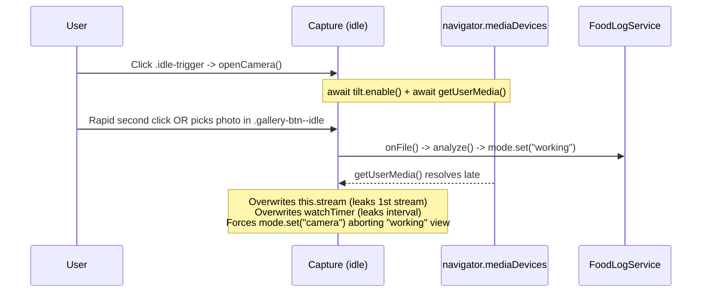

# Frontend QA Audit & Architecture Report — *CaloriesCounter*

This document captures the technical diagnostic following the refactoring toward the minimalist *zero-state* interface, the immersive (`100dvh`) viewfinder, and gyroscope-driven morphological animations.

---

## 1. State Management & Component Lifecycle

### 1.1. Race Conditions in Mode Transitions

1. **Re-entrancy in [`openCamera()`](file:///c:/Users/manue/Downloads/01_Academico/Sistemas_Inteligentes/CaloriesCounter/frontend/src/app/features/capture/capture.ts#L346-L377) and hardware leaks (`MediaStream` / `setInterval`)**:
   - The [`.idle-trigger`](file:///c:/Users/manue/Downloads/01_Academico/Sistemas_Inteligentes/CaloriesCounter/frontend/src/app/features/capture/capture.ts#L65) button is not disabled and there is no in-flight lock (`opening`) while `await this.tilt.enable()` and `await navigator.mediaDevices.getUserMedia(...)` resolve.
   - If the user taps twice quickly, the second invocation overwrites `this.stream` ([`capture.ts`](file:///c:/Users/manue/Downloads/01_Academico/Sistemas_Inteligentes/CaloriesCounter/frontend/src/app/features/capture/capture.ts#L360)) **without calling `track.stop()` on the first `MediaStream`** and overwrites `this.watchTimer` ([`capture.ts`](file:///c:/Users/manue/Downloads/01_Academico/Sistemas_Inteligentes/CaloriesCounter/frontend/src/app/features/capture/capture.ts#L376)) **without calling `clearInterval` on the previous timer**.
   - **Impact**: The OS camera indicator (green dot on iOS/Android) stays on permanently until the tab reloads, even after closing the camera, leaving an orphaned `setInterval` running every `100 ms`.

2. **Collision between in-flight [`openCamera()`](file:///c:/Users/manue/Downloads/01_Academico/Sistemas_Inteligentes/CaloriesCounter/frontend/src/app/features/capture/capture.ts#L346-L377), gallery selection ([`onFile()`](file:///c:/Users/manue/Downloads/01_Academico/Sistemas_Inteligentes/CaloriesCounter/frontend/src/app/features/capture/capture.ts#L447-L455)), and component destruction**:
   - While `getUserMedia` awaits OS permission, `mode()` remains `'idle'`. If the user selects an image from [`.gallery-btn--idle`](file:///c:/Users/manue/Downloads/01_Academico/Sistemas_Inteligentes/CaloriesCounter/frontend/src/app/features/capture/capture.ts#L94-L109) or navigates to `/history` (triggering [`ngOnDestroy()`](file:///c:/Users/manue/Downloads/01_Academico/Sistemas_Inteligentes/CaloriesCounter/frontend/src/app/features/capture/capture.ts#L457-L463)), the `getUserMedia` promise resumes after `await`, assigns `this.stream`, starts `this.watchTimer`, and forces `this.mode.set('camera')`, overriding `'working'` or leaving the camera active on a destroyed component.

3. **Unprotected async window during [`shoot()`](file:///c:/Users/manue/Downloads/01_Academico/Sistemas_Inteligentes/CaloriesCounter/frontend/src/app/features/capture/capture.ts#L412-L445)**:
   - On line 435, `await new Promise((resolve) => canvas.toBlob(resolve, 'image/jpeg', 0.95))` is asynchronous (~40–150 ms at Full HD on mobile).
   - During that `await`, [`.close`](file:///c:/Users/manue/Downloads/01_Academico/Sistemas_Inteligentes/CaloriesCounter/frontend/src/app/features/capture/capture.ts#L115-L122) and [`.gallery-btn`](file:///c:/Users/manue/Downloads/01_Academico/Sistemas_Inteligentes/CaloriesCounter/frontend/src/app/features/capture/capture.ts#L184-L199) remain active. If the user closes the camera in that window, [`closeCamera()`](file:///c:/Users/manue/Downloads/01_Academico/Sistemas_Inteligentes/CaloriesCounter/frontend/src/app/features/capture/capture.ts#L379-L392) calls [`cancelCountdown()`](file:///c:/Users/manue/Downloads/01_Academico/Sistemas_Inteligentes/CaloriesCounter/frontend/src/app/features/capture/capture.ts#L545) setting `this.capturing = false`, and milliseconds later `shoot()` resumes after `toBlob` and triggers `await this.analyze(shot)` unexpectedly.

4. **Blind window and uncanceled subscription in [`analyze()`](file:///c:/Users/manue/Downloads/01_Academico/Sistemas_Inteligentes/CaloriesCounter/frontend/src/app/features/capture/capture.ts#L591-L634)**:
   - `this.mode.set('working')` ([`capture.ts`](file:///c:/Users/manue/Downloads/01_Academico/Sistemas_Inteligentes/CaloriesCounter/frontend/src/app/features/capture/capture.ts#L612)) runs **after** `await Promise.all([compressImage(source), readFocal35mm(source)])`. While decoding and recompressing a large gallery image (200–600 ms), the UI stays in `'idle'` without locking or showing a spinner, allowing parallel `onFile()` or `openCamera()` triggers.
   - On line 615, `this.sub = this.logs.analyze(...)` is assigned **without first calling `this.sub?.unsubscribe()`**.
   - The `this.handedOver` flag ([`capture.ts`](file:///c:/Users/manue/Downloads/01_Academico/Sistemas_Inteligentes/CaloriesCounter/frontend/src/app/features/capture/capture.ts#L257)) is set to `true` when handing off to [`ResultStore`](file:///c:/Users/manue/Downloads/01_Academico/Sistemas_Inteligentes/CaloriesCounter/frontend/src/app/core/food-log/result.store.ts#L6-L23), but is not reset to `false` at the start of `analyze()`.

---

### 1.2. Memory Management, `<video>` DOM, Sensors & Audio

1. **Non-reactive dependency in `<video>` `effect()` and buffer retention**:
   - In [`Capture`](file:///c:/Users/manue/Downloads/01_Academico/Sistemas_Inteligentes/CaloriesCounter/frontend/src/app/features/capture/capture.ts#L337-L343), `this.stream` is a plain private field (not a `signal`). The `effect()` only works by coincidence because `this.videoRef()` changes when `@else if (mode() === 'camera')` mounts the `<video>` element.
   - Inside [`closeCamera()`](file:///c:/Users/manue/Downloads/01_Academico/Sistemas_Inteligentes/CaloriesCounter/frontend/src/app/features/capture/capture.ts#L379-L392), tracks are stopped (`track.stop()`), but **`videoEl.srcObject = null` is not cleared** before unmounting `<video>`, which delays hardware decoder buffer release on WebKit (iOS) across repeated camera sessions.

2. **`silenceTimer` leaks and axis mismatch in [`TiltService`](file:///c:/Users/manue/Downloads/01_Academico/Sistemas_Inteligentes/CaloriesCounter/frontend/src/app/core/tilt.service.ts#L66-L153)**:
   - In [`listen()`](file:///c:/Users/manue/Downloads/01_Academico/Sistemas_Inteligentes/CaloriesCounter/frontend/src/app/core/tilt.service.ts#L144-L153), `this.silenceTimer = setTimeout(...)` is assigned without clearing an existing `this.silenceTimer` if `enable()` is called multiple times.
   - In [`enable()`](file:///c:/Users/manue/Downloads/01_Academico/Sistemas_Inteligentes/CaloriesCounter/frontend/src/app/core/tilt.service.ts#L105-L127), `DeviceOrientationEvent.requestPermission()` is called on every camera open even when `this.permission()` is already `'granted'`, adding an unnecessary `await` before `getUserMedia()` that can consume transient user activation on iOS.
   - **Directional mismatch in landscape mode**: [`bubbleOffset()`](file:///c:/Users/manue/Downloads/01_Academico/Sistemas_Inteligentes/CaloriesCounter/frontend/src/app/core/tilt.service.ts#L46-L54) rotates axes with [`screenAngleDeg()`](file:///c:/Users/manue/Downloads/01_Academico/Sistemas_Inteligentes/CaloriesCounter/frontend/src/app/core/tilt.service.ts#L35-L40), whereas [`levelHint`](file:///c:/Users/manue/Downloads/01_Academico/Sistemas_Inteligentes/CaloriesCounter/frontend/src/app/features/capture/capture.ts#L324-L333) evaluates raw unrotated `beta()` and `gamma()`. In landscape orientation, the text hint contradicts bubble and arc movement.
   - **Euler interpolation discontinuity at ±90°**: Exponential smoothing in [`onOrientation`](file:///c:/Users/manue/Downloads/01_Academico/Sistemas_Inteligentes/CaloriesCounter/frontend/src/app/core/tilt.service.ts#L94-L96) linearly interpolates `e.beta` and `e.gamma`; when `gamma` wraps between $+89^\circ$ and $-89^\circ$, `smoothGamma` sweeps artificially through $0^\circ$, causing an animation snap.

3. **Blocked `AudioContext` on iOS Safari ([`chime()`](file:///c:/Users/manue/Downloads/01_Academico/Sistemas_Inteligentes/CaloriesCounter/frontend/src/app/features/capture/capture.ts#L673-L694))**:
   - `this.audio ??= new Ctx()` is neither initialized nor unlocked inside the user gesture in `openCamera()`. Its first call happens inside the `setInterval` callback in [`evaluateTilt()`](file:///c:/Users/manue/Downloads/01_Academico/Sistemas_Inteligentes/CaloriesCounter/frontend/src/app/features/capture/capture.ts#L499). On iOS Safari, an `AudioContext` created outside a direct user gesture stays `'suspended'`, muting level-lock and countdown chimes.

---

## 2. Rendering & Advanced CSS (Morphological Animation)

### 2.1. Math of `gaps()`, Subpixels & Quarter-Circle Geometry

> [!IMPORTANT]
> There is a direct geometric contradiction between the documented intent in [`gaps()`](file:///c:/Users/manue/Downloads/01_Academico/Sistemas_Inteligentes/CaloriesCounter/frontend/src/app/features/capture/capture.ts#L288-L302) (*"the arc opens on the low side, which is the side to lift"*) and the CSS transforms on [`.arc`](file:///c:/Users/manue/Downloads/01_Academico/Sistemas_Inteligentes/CaloriesCounter/frontend/src/app/features/capture/capture.scss#L249-L283).

1. **The low side does NOT open on single-axis tilt**:
   - Transforms in [`capture.scss`](file:///c:/Users/manue/Downloads/01_Academico/Sistemas_Inteligentes/CaloriesCounter/frontend/src/app/features/capture/capture.scss#L249-L283) are:
     - `.arc--tl`: `translate(calc(var(--left) * -1), calc(var(--up) * -1))`
     - `.arc--tr`: `translate(var(--right), calc(var(--up) * -1))`
     - `.arc--br`: `translate(var(--right), var(--down))`
     - `.arc--bl`: `translate(calc(var(--left) * -1), var(--down))`
   - When tilted solely on the vertical axis (e.g. bottom edge low -> `--down: 28px`, `--up: 0px`, `--left: 0px`, `--right: 0px`), both `.arc--bl` and `.arc--br` translate by `(0px, +28px)`.
   - With `0px` X-offset, **the two bottom quarters remain joined at 6 o'clock**: the bottom edge never opens; instead, the circle splits horizontally across the equator (at 9 and 3 o'clock) into two rigid hemispheres.

2. **Visible subpixel hairline seams when closed (`0px`)**:
   - [`.frame`](file:///c:/Users/manue/Downloads/01_Academico/Sistemas_Inteligentes/CaloriesCounter/frontend/src/app/features/capture/capture.scss#L222-L235) uses `width: min(64vw, 240px); aspect-ratio: 1;` and each `.arc` is `50% × 50%` with `will-change: transform`.
   - On fractional `devicePixelRatio` screens (`2.625`, `2.75`, `3.5`) or non-even widths, promoting each `.arc` to its own GPU layer with semi-transparent borders and per-arc `drop-shadow(...)` produces a 1-device-pixel seam at cardinal joints (12, 3, 6, 9 o'clock).

3. **Discontinuous snap when crossing `isLevel()` hysteresis**:
   - In [`gaps()`](file:///c:/Users/manue/Downloads/01_Academico/Sistemas_Inteligentes/CaloriesCounter/frontend/src/app/features/capture/capture.ts#L294), when `isLevel()` becomes `true` at `levelEnter = 8°`, gaps jump from `8px` ($\approx 28 \times 8/30$) to `0px`, and on exit (`levelExit = 12°`) jump from `0px` to `11px`.

4. **Missing morphological transition between `idle` and `camera`**:
   - `@if (mode() === 'idle')` and `@else if (mode() === 'camera')` ([`capture.ts`](file:///c:/Users/manue/Downloads/01_Academico/Sistemas_Inteligentes/CaloriesCounter/frontend/src/app/features/capture/capture.ts#L54-L138)) mount separate DOM trees, so the 4 arcs never animate smoothly from the `28px` idle state to the live gyroscope reading.

---

### 2.2. Performance, Change Detection & FPS Drops

1. **60–100 Hz gyroscope events inside `NgZone` + Dual clock**:
   - [`window.addEventListener('deviceorientation', ...)`](file:///c:/Users/manue/Downloads/01_Academico/Sistemas_Inteligentes/CaloriesCounter/frontend/src/app/core/tilt.service.ts#L146) runs inside `NgZone`. Even though [`onOrientation`](file:///c:/Users/manue/Downloads/01_Academico/Sistemas_Inteligentes/CaloriesCounter/frontend/src/app/core/tilt.service.ts#L88) throttles at `50 ms` (20 Hz), **Zone.js intercepts all 60–100 native events/sec** before the early return, triggering unnecessary change detection.
   - A second polling loop (`watchTimer = setInterval(..., 100)`) runs out of phase with `TiltService` signals (20 Hz vs 10 Hz), adding up to `100 ms` desync between bubble position and green ready state.

2. **Double damping (JS EMA + CSS `transition: transform 0.12s linear`)**:
   - Updating `transform` every `50 ms` on a `120 ms` CSS transition forces mid-flight interpolation cancellation on every tick, adding ~150 ms of input lag. Quantizing `gaps()` with `Math.round(...)` also introduces 1 px stepping.

3. **GPU overload from stacked `backdrop-filter: blur()` over 1080p `<video>`**:
   - `.viewfinder` stacks up to 5 `backdrop-filter: blur(...)` layers (`.close`, `.shutter`, `.gallery-btn`, `.notice`, `.countdown`) plus 4 `.arc` layers with `filter: drop-shadow(...)`, causing frame drops during `countdown-pop` on mid-range mobile devices.

---

## 3. Immersive Mobile Layout (`100dvh`) & Safe Areas

### 3.1. Vertical Overflow in `.idle-stage` & `100dvh` Behavior

In `idle` state, total vertical height is:

$$\text{Total Height} = \underbrace{\text{topbar-h} + \text{safe-top}}_{\text{.topbar}} + \underbrace{100\text{dvh} - \text{topbar-h} - \text{nav-h} - \text{safe-bottom}}_{\text{.idle-stage (min-height)}} + \underbrace{\text{nav-h} + \text{safe-bottom} + \text{space-4}}_{\text{main.with-nav (padding-bottom)}} = 100\text{dvh} + \text{safe-top} + 20\text{px}$$

1. **Parasitic `20px + env(safe-area-inset-top)` scroll on `idle` screen**:
   - [`.idle-stage`](file:///c:/Users/manue/Downloads/01_Academico/Sistemas_Inteligentes/CaloriesCounter/frontend/src/app/features/capture/capture.scss#L20) forgets to subtract `padding-top: env(safe-area-inset-top, 0px)` from [`.topbar`](file:///c:/Users/manue/Downloads/01_Academico/Sistemas_Inteligentes/CaloriesCounter/frontend/src/app/app.scss#L5) and `+ var(--space-4)` (`20px`) from [`main.with-nav`](file:///c:/Users/manue/Downloads/01_Academico/Sistemas_Inteligentes/CaloriesCounter/frontend/src/app/app.scss#L82), causing residual vertical scroll (`20px`–`79px`) and mobile address-bar layout shifts.

2. **Background scroll unlocked while `.viewfinder` (`position: fixed`) is open**:
   - Entering `mode() === 'camera'` does not lock `body` scroll (`overflow: hidden` / `overscroll-behavior: none`), allowing iOS Safari rubber-banding on the underlying page.

3. **Landscape layout breakage**:
   - On mobile landscape (`~360–414px` height), `.frame` (`240px`) overlaps `.camera-bar` (`146px`), `.shutter-readout`, and `.notice`.

---

### 3.2. Floating Control Collisions, Safe Areas & `z-index`

| Element | File | Position / `z-index` | Detected Issue |
| :--- | :--- | :--- | :--- |
| `.notice` vs `.shutter-readout` | [`capture.scss`](file:///c:/Users/manue/Downloads/01_Academico/Sistemas_Inteligentes/CaloriesCounter/frontend/src/app/features/capture/capture.scss#L295-L400) | `bottom: calc(128px + var(--safe-bottom))` vs `116px–156px + var(--safe-bottom)` | **Direct collision**: When `prefs.bubbleLevel()` is enabled, `.notice` renders directly over `.shutter-readout`. |
| `.viewfinder` vs `.idle-warning` | [`capture.scss`](file:///c:/Users/manue/Downloads/01_Academico/Sistemas_Inteligentes/CaloriesCounter/frontend/src/app/features/capture/capture.scss#L171) / [`app.scss`](file:///c:/Users/manue/Downloads/01_Academico/Sistemas_Inteligentes/CaloriesCounter/frontend/src/app/app.scss#L173) | `z-index: 50` vs `z-index: 40` | Inactivity session-expiry warning renders **hidden behind the camera**, logging out the user unseen. |
| `.idle-warning` | [`app.scss`](file:///c:/Users/manue/Downloads/01_Academico/Sistemas_Inteligentes/CaloriesCounter/frontend/src/app/app.scss#L172) | `bottom: calc(var(--tabbar-h, 64px) + var(--space-4))` | References undefined `--tabbar-h` (token in [`_tokens.scss`](file:///c:/Users/manue/Downloads/01_Academico/Sistemas_Inteligentes/CaloriesCounter/frontend/src/styles/_tokens.scss#L43) is `--nav-h`) and omits `+ var(--safe-bottom)`. |
| `.idle-fallback` & `.gallery-btn--idle` | [`capture.scss`](file:///c:/Users/manue/Downloads/01_Academico/Sistemas_Inteligentes/CaloriesCounter/frontend/src/app/features/capture/capture.scss#L108-L110) / [`#L548-L553`](file:///c:/Users/manue/Downloads/01_Academico/Sistemas_Inteligentes/CaloriesCounter/frontend/src/app/features/capture/capture.scss#L548-L553) | `bottom: var(--space-5); left/right: var(--space-5)` | Missing `env(safe-area-inset-left/right)` in landscape; on narrow `320px` screens `.idle-fallback` approaches `.gallery-btn--idle`. |
| `.close` & `.camera-bar` | [`capture.scss`](file:///c:/Users/manue/Downloads/01_Academico/Sistemas_Inteligentes/CaloriesCounter/frontend/src/app/features/capture/capture.scss#L197-L198) / [`#L409`](file:///c:/Users/manue/Downloads/01_Academico/Sistemas_Inteligentes/CaloriesCounter/frontend/src/app/features/capture/capture.scss#L409) | `left: var(--space-4)` / `padding-inline: var(--space-5)` | Omit `env(safe-area-inset-left/right)`, overlapping notches/camera cutouts in landscape. |
| `.drawer` | [`drawer.scss`](file:///c:/Users/manue/Downloads/01_Academico/Sistemas_Inteligentes/CaloriesCounter/frontend/src/app/core/ui/drawer.scss#L22) | `padding-bottom: var(--space-5)` | Omits `+ var(--safe-bottom)`, placing Sign Out flush against the iOS Home Indicator. |
| `.sheet` (Results) | [`result.scss`](file:///c:/Users/manue/Downloads/01_Academico/Sistemas_Inteligentes/CaloriesCounter/frontend/src/app/features/result/result.scss#L510) | `max-height: 84vh` | Uses static `vh` instead of `dvh`; opening the virtual keyboard during edits ([`result.ts`](file:///c:/Users/manue/Downloads/01_Academico/Sistemas_Inteligentes/CaloriesCounter/frontend/src/app/features/result/result.ts#L414-L436)) covers search results. |

---

## 4. Accessibility (a11y) & Usability (UX)

1. **False affordance on unleveled shutter**:
   - When `canShoot()` is `false`, [`.shutter`](file:///c:/Users/manue/Downloads/01_Academico/Sistemas_Inteligentes/CaloriesCounter/frontend/src/app/features/capture/capture.scss#L424-L490) still shows a 92% white ring and solid white core (`#ffffff`), which looks ready-to-shoot on iOS/Android. It also lacks `aria-disabled="true"` when `!canShoot()`.

2. **Low contrast of `.arc` and `.shutter-readout` on bright backgrounds**:
   - [`.arc`](file:///c:/Users/manue/Downloads/01_Academico/Sistemas_Inteligentes/CaloriesCounter/frontend/src/app/features/capture/capture.scss#L240) uses `rgb(255 255 255 / 72%)` without a dark halo, disappearing over white plates/tablecloths. [`.shutter-readout`](file:///c:/Users/manue/Downloads/01_Academico/Sistemas_Inteligentes/CaloriesCounter/frontend/src/app/features/capture/capture.scss#L295-L327) lacks a translucent dark pill to guarantee WCAG AA (4.5:1) contrast over bright video.

3. **Color mismatch between accent themes (`data-accent`) and "Level" state**:
   - [`.frame--ready` / `.shutter--ready`](file:///c:/Users/manue/Downloads/01_Academico/Sistemas_Inteligentes/CaloriesCounter/frontend/src/app/features/capture/capture.scss#L288-L290) use `var(--c-primary)` with hardcoded green shadows (`rgb(22 163 74 / ...)`). With **Orange** or **Pink** accents in [`_tokens.scss`](file:///c:/Users/manue/Downloads/01_Academico/Sistemas_Inteligentes/CaloriesCounter/frontend/src/styles/_tokens.scss#L79-L89), the "ready" ring turns orange/red (matching alert semantics) with a green glow.

4. **Keyboard focus loss & semantics on gallery buttons (`<label><input class="sr-only"></label>`)**:
   - Focus lands on the hidden `<input type="file" class="sr-only">`, while `<label>` lacks `:focus-within` styles and holds the `aria-label` instead of `<input>`. Background `<header>`/`<nav>` also remain in the tab order while `.viewfinder` is open.

5. **`prefers-reduced-motion: reduce` freezes loading indicators**:
   - Global `* { animation-duration: 0.01ms !important }` in [`_base.scss`](file:///c:/Users/manue/Downloads/01_Academico/Sistemas_Inteligentes/CaloriesCounter/frontend/src/styles/_base.scss#L100-L105) stops `.spinner` and `.scan` during `'working'`, making the app look frozen.

---

## 5. Prioritized Findings Matrix

### High Priority (Critical: Resource leaks, race conditions & UI collisions)

1. **[State / Lifecycle]** Lock re-entrancy in [`openCamera()`](file:///c:/Users/manue/Downloads/01_Academico/Sistemas_Inteligentes/CaloriesCounter/frontend/src/app/features/capture/capture.ts#L346-L377) and verify after every `await` that the component wasn't destroyed or switched to `'working'`, stopping any orphaned `MediaStream`.
2. **[State / Lifecycle]** Guard [`shoot()`](file:///c:/Users/manue/Downloads/01_Academico/Sistemas_Inteligentes/CaloriesCounter/frontend/src/app/features/capture/capture.ts#L412-L445) and [`analyze()`](file:///c:/Users/manue/Downloads/01_Academico/Sistemas_Inteligentes/CaloriesCounter/frontend/src/app/features/capture/capture.ts#L591-L634): enter `mode.set('working')` **before** `compressImage()`, cancel previous subscriptions (`this.sub?.unsubscribe()`), and reset `this.handedOver = false`.
3. **[Morphological CSS]** Fix [`gaps()`](file:///c:/Users/manue/Downloads/01_Academico/Sistemas_Inteligentes/CaloriesCounter/frontend/src/app/features/capture/capture.ts#L292-L302) and [`.arc`](file:///c:/Users/manue/Downloads/01_Academico/Sistemas_Inteligentes/CaloriesCounter/frontend/src/app/features/capture/capture.scss#L236-L291) geometry so the ring opens on the low side, remove the `levelEnter`/`levelExit` snap, and eliminate cardinal subpixel seams.
4. **[Layout / Safe Areas]** Fix the vertical collision between [`.notice`](file:///c:/Users/manue/Downloads/01_Academico/Sistemas_Inteligentes/CaloriesCounter/frontend/src/app/features/capture/capture.scss#L379-L400) and [`.shutter-readout`](file:///c:/Users/manue/Downloads/01_Academico/Sistemas_Inteligentes/CaloriesCounter/frontend/src/app/features/capture/capture.scss#L295-L327), and fix the `20px + env(safe-area-inset-top)` overflow in [`.idle-stage`](file:///c:/Users/manue/Downloads/01_Academico/Sistemas_Inteligentes/CaloriesCounter/frontend/src/app/features/capture/capture.scss#L16-L25).
5. **[Sensors / iOS Audio]** Unlock `AudioContext` inside the user gesture in `openCamera()` and rotate `beta`/`gamma` via `screenAngleDeg()` in [`levelHint`](file:///c:/Users/manue/Downloads/01_Academico/Sistemas_Inteligentes/CaloriesCounter/frontend/src/app/features/capture/capture.ts#L324-L333) to match [`bubbleOffset()`](file:///c:/Users/manue/Downloads/01_Academico/Sistemas_Inteligentes/CaloriesCounter/frontend/src/app/core/tilt.service.ts#L46-L54).

### Medium Priority (Performance, Z-Index stacking & contrast)

6. **[Performance]** Run `deviceorientation` in [`TiltService`](file:///c:/Users/manue/Downloads/01_Academico/Sistemas_Inteligentes/CaloriesCounter/frontend/src/app/core/tilt.service.ts#L146) outside `NgZone` (`NgZone.runOutsideAngular`), remove redundant `watchTimer` polling, and shorten `transition: transform` on `.arc` / `.shutter__bubble`.
7. **[Layout / Z-Index]** Raise [`.idle-warning`](file:///c:/Users/manue/Downloads/01_Academico/Sistemas_Inteligentes/CaloriesCounter/frontend/src/app/app.scss#L169-L198) `z-index` above `.viewfinder` (`> 50`), replace `--tabbar-h` with `var(--nav-h) + var(--safe-bottom)`, and lock `body` scroll when `mode() === 'camera'`.
8. **[UX / Contrast]** Add a dark halo to `.arc` and a translucent pill to `.shutter-readout`; visually distinguish disabled shutter (`!canShoot()`) and use a semantic `--c-success: #16a34a` token for level-ready state.
9. **[Video Lifecycle]** Convert `this.stream` into a signal and clear `video.srcObject = null` in `closeCamera()`.

### Low Priority (Accessibility polish, landscape & UI details)

10. **[Accessibility]** Move `aria-label` to `<input type="file">` in `.gallery-btn` / `.idle-fallback`, add `:focus-within` on `<label>`, apply `inert` to `header`/`nav` while `.viewfinder` is open, and keep a subtle pulse on `.spinner` under `prefers-reduced-motion: reduce`.
11. **[Safe Areas / Landscape]** Add `env(safe-area-inset-left/right)` to floating controls, add `var(--safe-bottom)` to `.drawer`, and adapt `.viewfinder` for landscape (`@media (orientation: landscape) and (max-height: 500px)`).
12. **[Idle -> Camera Animation]** Unify or animate `.frame` entry from `idle` (`28px`) to `camera` for a smooth initial arc close.
